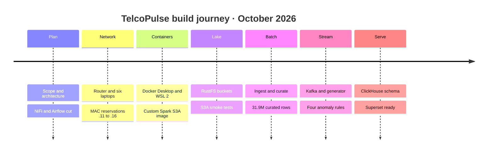
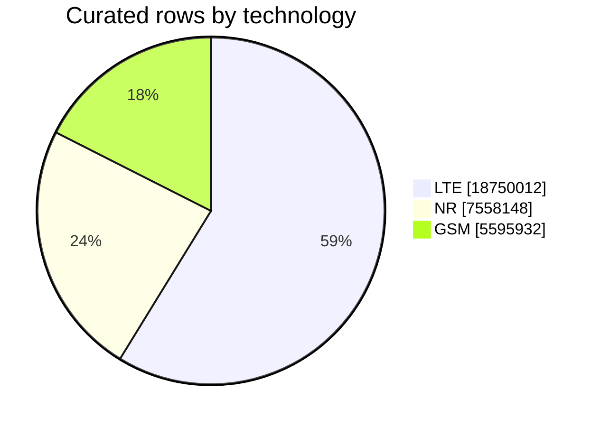
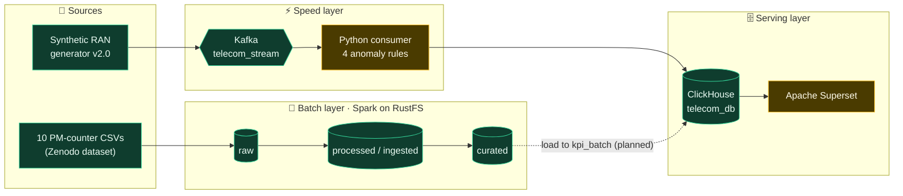
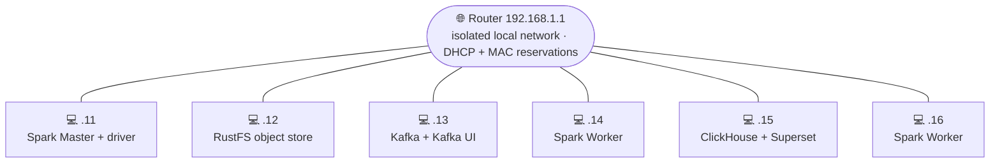
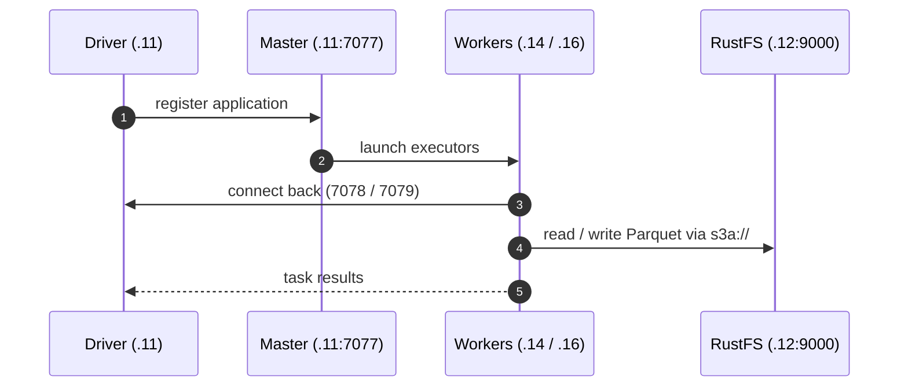
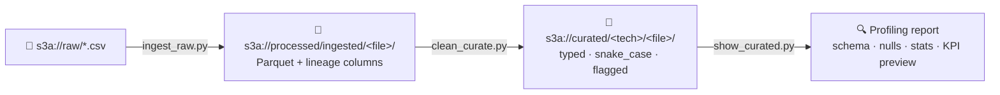
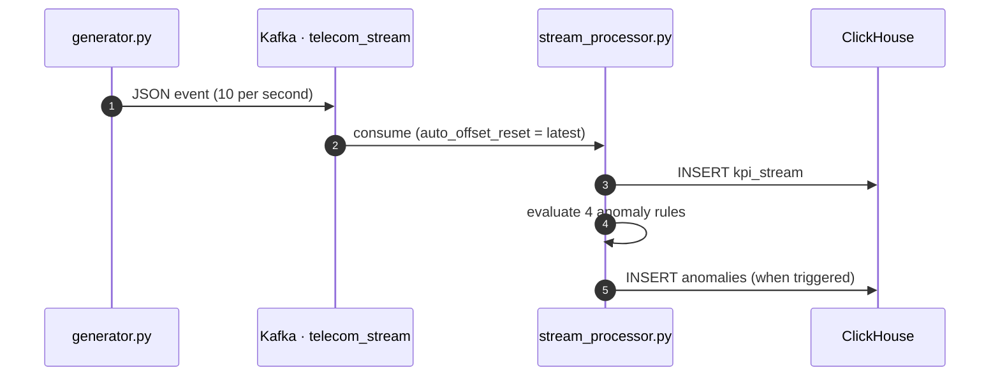
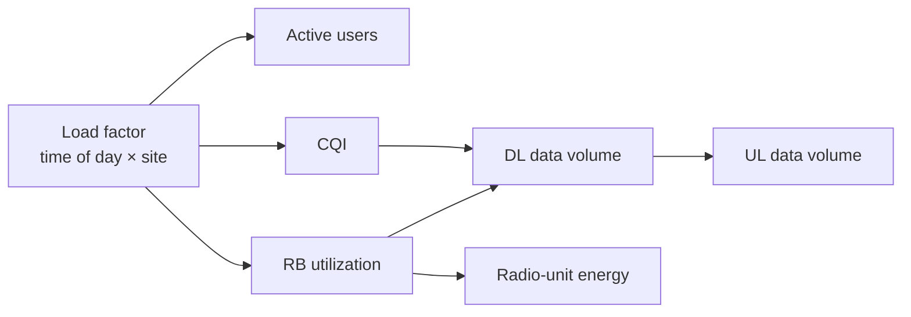
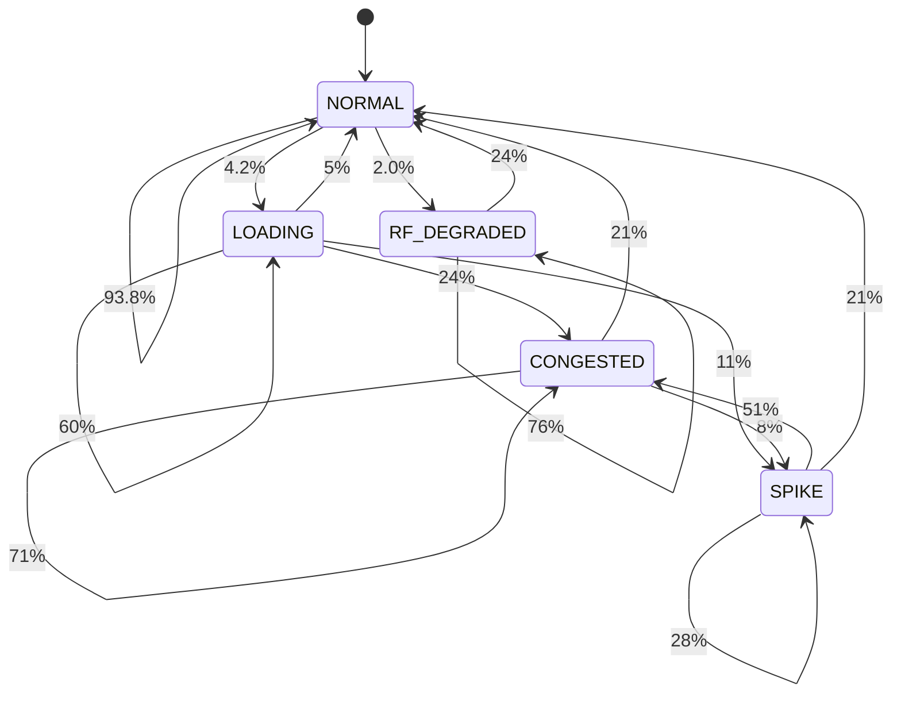

<div align="center">

<!-- ═════════════ PIPELINE SHOWCASE — FIRST ELEMENT ═════════════ -->


<a href="https://github.com/MohammedAhmed-01/TelcoPulseCluster">

</a>

<br/>


-f0ad4e?style=flat-square)


<br/>

<table align="center">
<tr>
<td align="center"><h2>31.9M</h2><sub>curated rows</sub></td>
<td align="center"><h2>279</h2><sub>base stations</sub></td>
<td align="center"><h2>3</h2><sub>technologies<br/>2G · 4G · 5G</sub></td>
<td align="center"><h2>6</h2><sub>physical laptops</sub></td>
<td align="center"><h2>10 / s</h2><sub>simulated events</sub></td>
<td align="center"><h2>5</h2><sub>ClickHouse tables</sub></td>
</tr>
</table>

<br/>

**[Overview](#overview) · [Results](#results) · [Architecture](#architecture) · [Network](#network) · [Spark](#spark) · [Data Lake](#datalake) · [Dataset](#dataset) · [Batch](#batch) · [Streaming](#streaming) · [Anomalies](#anomalies) · [ClickHouse](#clickhouse) · [Dashboards](#dashboards) · [Quick Start](#quickstart) · [Troubleshooting](#troubleshooting) · [Roadmap](#roadmap) · [Team](#team)**

</div>

<br/>

<a id="overview"></a>
<div align="center">


</div>

**TelcoPulse** is an end-to-end data engineering platform for **Radio Access Network (RAN) analytics**. It ingests historical 5G / 4G / 2G performance-management counters in batch **and** simulates a live telemetry feed, then serves both through a single analytical store with dashboards and automated anomaly detection.

The whole stack runs on a **six-laptop home-lab cluster** (`192.168.1.11` – `192.168.1.16`) joined by a local router. Spark, Kafka, ClickHouse/Superset and object storage live on separate nodes as Linux containers (Docker Desktop, WSL 2) — a realistic playground for distributed-systems problems: networking, listener configuration, S3A connectivity and cross-node data movement.

> [!IMPORTANT]
> TelcoPulse is a **local educational lab, not a production telecom deployment**. It processes public and synthetic data only. The streaming source is a **synthetic generator**, never a live operator feed.

### 📇 Project card

| | |
|---|---|
| 🏷 **Title** | TelcoPulse: A Distributed Telecom Big Data Analytics Platform |
| 🎓 **Programme** | Huawei HCIA Big Data training · National Telecommunication Institute (NTI) |
| 👨‍🏫 **Presented to** | Eng. Ahmed Hassan |
| 🗓 **Period** | October 2026 (ten days: eight implementation, two testing and evaluation) |
| 🖥 **Infrastructure** | 6 physical Windows laptops · Docker Desktop (WSL 2) · one local router |
| 📡 **Domain** | 2G / 4G / 5G RAN performance telemetry |
| 📚 **Documentation** | A complete project book accompanies the repo — see [Documentation](#documentation) |

### ✨ Highlights

| | Capability | What it does |
|:-:|---|---|
| 🧱 | **Medallion-style lakehouse** | `raw → processed/ingested → curated` Parquet layers on an S3-compatible object store |
| ⚡ | **Distributed Spark processing** | Custom Spark 3.5.9 image with `hadoop-aws` / AWS SDK baked in for S3A access |
| 📡 | **Realistic RAN simulator** | Circadian traffic, site profiles, tech × band calibration, correlated KPIs, Markov anomaly engine |
| 🚨 | **Real-time anomaly rules** | 4 rule-based detectors with severity grading and numeric anomaly scores |
| 🗄️ | **Columnar serving layer** | ClickHouse `MergeTree` tables, partitioned and ordered for time-series queries |
| 📊 | **One-command analytics bootstrap** | `setup.sh` boots ClickHouse + Superset, installs the driver and creates the admin user |
| ✅ | **Built-in data-quality audit** | Null / non-numeric / timestamp / duplicate-key checks with row-count reconciliation |

### 🧭 Scope decisions

| Item | Decision |
|---|---|
| Apache NiFi · Apache Airflow | **Cut from the ten-day scope** — not deployed |
| Live operator feed | **Excluded** — synthetic events only |
| High availability · production hardening | Not attempted |
| Hosts | Windows 10/11 laptops with Docker Desktop — no native Linux servers |

### 🛤 Project journey



<br/>

<a id="results"></a>
<div align="center">


</div>



| Metric | Value |
|---|--:|
| Source files | **10** CSV files (**9** reached the Curated layer) |
| Radio technologies | **3** — 2G GSM · 4G LTE · 5G NR |
| 🟦 LTE rows (curated) | **18,750,012** *(58.8 %)* |
| 🟪 NR rows (curated) | **7,558,148** *(23.7 %)* |
| 🟩 GSM rows (curated) | **5,595,932** *(17.5 %)* |
| **Total curated rows** | **31,904,092** |
| Rows carrying network metrics | 27,275,186 *(85.5 %)* |
| Distinct base stations | **279** (LTE, NR) · 263 (GSM) |
| Time range | `2023-03-03 08:30` → `2025-11-22 23:30` |
| Cluster | **6** laptops · 1 router |
| Stream rate (simulator) | **10 events / second** across 4 sites / 21 cells |

> [!NOTE]
> The earlier all-in-one job (`batch_all_10.py`) writes a different, intermediate *Processed* dataset (`telcopulse_batch_v1`; an earlier run reported 34,117,453 rows in 44 Parquet files). That figure is **not comparable** to the Curated totals — Curated is produced per file by `clean_curate.py`.

> [!CAUTION]
> `Dataset_03_NR_3500.csv` failed during ingestion (executors lost), so the NR figure and the grand total **exclude it**. See [Quick Start](#quickstart) for the one-file re-run.

<br/>

<a id="architecture"></a>
<div align="center">


</div>

TelcoPulse follows a **Lambda-style design**: a batch layer for historical data, a speed layer for live telemetry and a shared serving layer. The five logical layers are infrastructure → storage (RustFS) → processing (Spark, Kafka) → analytical storage (ClickHouse) → presentation (Superset); data quality and anomaly detection cut across them.



<div align="center">

🟩 working &nbsp;·&nbsp; 🟨 partly working &nbsp;·&nbsp; dotted line = planned

</div>

### 🖥 Cluster layout



| Node | Role | Services | Key ports |
|---|---|---|:-:|
| `192.168.1.11` | **Compute** | Spark Master + driver | `7077` `8080` `7078` `7079` `4040` |
| `192.168.1.12` | **Object store** | RustFS (S3-compatible) | `9000` API · `9001` console |
| `192.168.1.13` | **Messaging** | Kafka broker (KRaft) + Kafka UI | `9092` · `8080` |
| `192.168.1.14` | **Compute** | Spark Worker | `8081` |
| `192.168.1.15` | **Serving** | ClickHouse + Superset | `8123` · `9000` · `8088` |
| `192.168.1.16` | **Compute** | Spark Worker | `8081` |

> [!NOTE]
> These are the private LAN addresses of the lab. Change them in `spark-defaults.conf`, the Kafka `ADVERTISED_LISTENERS`, and the Python connection constants to match your network.

### 🔀 Original design vs. what was built

The repository is the source of truth. Where the original design and the as-built system differ, **this README documents the as-built version**.

| Topic | Original design | As built |
|---|---|---|
| Stream engine | Spark Structured Streaming, 1-minute windows | Plain **Python Kafka consumer**; each event carries a 300 s window |
| Kafka address / topic | `192.168.1.12:9092` / `telco.events` | **`192.168.1.13:9092`** / **`telecom_stream`** |
| Anomaly detection | Rolling z-score (3σ) | **Four threshold rules** |
| Batch jobs | `batch_ingest_process`, `batch_curate`, `load_clickhouse_batch` | `ingest_raw.py`, `clean_curate.py`, `show_curated.py`, `batch_all_10.py` |
| Batch → ClickHouse | Spark loader into `kpi_batch` | **Not implemented yet** |
| Curated layer | 10 files | **9 files** (`Dataset_03_NR_3500` pending) |
| Superset dashboards | Six, provisioned | Provisioning script is empty — dashboards are **specified, not yet built** |

<br/>

<a id="network"></a>
<div align="center">


</div>

Every service address is hard-coded in configuration (Spark master URL, S3A endpoint, Kafka advertised listener, ClickHouse URL). If a laptop received a new IP after a reboot, the cluster would break — so the lab uses **DHCP reservations** on the router.

### 🛜 Router facts

- A **Huawei HG531 V1** ADSL router (Vodafone-branded) provided only the **local network**. Its WAN side reported *Disconnected*, so the cluster is an **isolated LAN**.
- Gateway `192.168.1.1` · mask `255.255.255.0` · DHCP pool `192.168.1.2 – 254` · lease 1 day. Fixed addresses `.11`–`.16` are kept through **IP/MAC address reservations**.
- Laptops joined over a mix of Ethernet and Wi-Fi, so benchmarks must not be read as representative of a wired data-centre fabric.

> [!WARNING]
> With no Internet on the lab network, every container image, Maven JAR and dataset must be **downloaded before** the laptops join it.

### 🪜 Reserving fixed addresses

| Step | What to do |
|:-:|---|
| 1 | Connect all laptops to the same router (Wi-Fi or Ethernet). |
| 2 | On each laptop run `getmac /v` and note the MAC of the adapter that is **actually connected** (ignore VMware / Bluetooth adapters). |
| 3 | In the router: **Basic → LAN → DHCP → IP Address Reserve → New**. Enter the MAC (use `:` separators) and the fixed IP. |
| 4 | Reserve one address per laptop in `192.168.1.11 – 192.168.1.16`, then press **Submit**. |
| 5 | Reconnect each laptop and verify with `ipconfig`, `ping` and `Test-NetConnection -Port <port>`. |

> [!TIP]
> If a laptop does not get its reserved address, check that Windows *random hardware addresses* is off for the Wi-Fi network and that the reserved MAC belongs to the adapter really in use. Step-by-step screenshots are in the project book.

### 🐳 Containers

Every host is a Windows laptop running **Docker Desktop (WSL 2 backend)**; services run as Linux containers defined with Docker Compose. Persistent data lives on host paths (e.g. `G:/TelcoPulse/data/rustfs`).

### 📍 Four address concepts

| Concept | Example | Reachable from |
|---|---|---|
| Physical host IP | `192.168.1.12` | Every device on the LAN |
| Container IP | `172.17.x.x` (Docker bridge) | Inside that laptop only |
| Published host port | host `:9000` → container `:9000` | The LAN, via the host IP |
| **Service endpoint** | `192.168.1.12:9000` | What clients and executors must be configured with |

### 🩺 Layered connectivity validation

A successful `ping` proves only ICMP. Validate in layers:

```powershell
ping 192.168.1.11                                   # 1. reachability
Test-NetConnection 192.168.1.11 -Port 7077          # 2. TCP port
Invoke-RestMethod http://192.168.1.15:8123/ping     # 3. application level → "Ok."
```

<br/>

<a id="spark"></a>
<div align="center">


</div>

| Item | Value |
|---|---|
| Master container | `tp-spark-master` (`spark-class org.apache.spark.deploy.master.Master`) |
| Master endpoint | `spark://192.168.1.11:7077` · UI `:8080` |
| Base image | `apache/spark:3.5.9-scala2.12-java11-python3-r-ubuntu` |
| Application image | **`telcopulse-spark-s3a:3.5.9`** — adds `hadoop-aws 3.3.4` + `aws-java-sdk-bundle 1.12.262` |
| Driver networking | `spark.driver.host=192.168.1.11` · `bindAddress=0.0.0.0` · driver port `7078` · block manager `7079` |
| Workers | Containers on `.14` and `.16` (UI `8081`); observed executors: 2 cores · 1024 MB each |



> [!NOTE]
> Executors — not only the driver — read from storage, so the S3 endpoint must be reachable from **every** worker laptop and the driver ports must be reachable from every worker. Pinning driver and block-manager ports makes firewall rules predictable. In `spark-defaults.conf`, the `spark.master.*` lines are not real Spark properties and have no effect — the Master is configured by the arguments in `docker/docker-compose.yml`.

<br/>

<a id="datalake"></a>
<div align="center">


</div>

Three buckets separate data by processing stage, protecting original data and giving downstream consumers a stable, cleaned dataset.

| Zone | Purpose | Format | Path |
|---|---|---|---|
| 🥉 **Raw** | Original ingested data, unchanged | CSV | `s3a://raw/Dataset_*.csv` |
| 🥈 **Processed** | Intermediate stage with lineage columns | Parquet | `s3a://processed/ingested/<file>/` |
| 🥇 **Curated** | Final cleaned, typed datasets | Parquet | `s3a://curated/<lte\|nr\|gsm>/<file>/` |

**S3A settings** (path-style addressing, because a bare IP has no DNS name for virtual-hosted buckets):

| Property | Value |
|---|---|
| `fs.s3a.endpoint` | `http://192.168.1.12:9000` |
| `fs.s3a.path.style.access` | `true` |
| `fs.s3a.connection.ssl.enabled` | `false` (plain HTTP inside the isolated lab) |
| `fs.s3a.aws.credentials.provider` | `SimpleAWSCredentialsProvider` |
| Credentials | environment variables `AWS_ACCESS_KEY_ID` / `AWS_SECRET_ACCESS_KEY` |

> [!NOTE]
> The final implementation uses **RustFS**. Early design material and the early host folder name (`data\minio`) refer to MinIO — treat those as historical; the two products have different images, consoles and configuration.

### 🧰 Tech stack

| Layer | Technology | Purpose |
|---|---|---|
| **Object storage** | RustFS | S3-compatible lake with `raw`, `processed`, `curated` buckets |
| **Batch compute** | Apache Spark 3.5.9 (PySpark) | Ingestion, cleaning, curation, profiling |
| **S3 connector** | `hadoop-aws 3.3.4` + `aws-java-sdk-bundle 1.12.262` | `s3a://` access from Spark |
| **Messaging** | Apache Kafka 4.1.0 (KRaft, no ZooKeeper) | Real-time telemetry transport |
| **Kafka tooling** | Kafka UI (Provectus) | Topic / consumer inspection |
| **Stream processing** | Python · `kafka-python` · `requests` | Consume → write KPIs → detect anomalies |
| **Simulation** | Python · NumPy | Physically-correlated synthetic RAN telemetry |
| **Warehouse** | ClickHouse | Columnar OLAP serving layer |
| **BI** | Apache Superset + `clickhouse-connect` | Dashboards and exploration |
| **Orchestration** | Docker · Docker Compose · PowerShell · Bash | Reproducible deployment |

<br/>

<a id="dataset"></a>
<div align="center">


</div>

Historical data comes from live-network **performance-management counters** published on Zenodo ([`10.5281/zenodo.17815388`](https://doi.org/10.5281/zenodo.17815388)), recorded at **15-minute intervals** (about 767 MB as initially reported). The generator's behaviour is additionally calibrated against 4G LTE field traces ([`10.5281/zenodo.1219679`](https://doi.org/10.5281/zenodo.1219679)).

**10 CSV files · 3 dataset groups · 3 radio technologies · 6 frequency bands.** Technology and frequency are parsed from the file name (`Dataset_<group>_<TECH>_<MHz>.csv`) and attached as columns during ingestion.

| File | Tech | Band (MHz) | Curated rows | Duplicate keys · extra rows | Rows with metrics |
|---|:-:|:-:|--:|--:|--:|
| `Dataset_01_LTE_2100` | 4G LTE | 2100 | 151,026 | 0 · 0 | 147,470 |
| `Dataset_01_NR_1800` | 5G NR | 1800 | 151,026 | 0 · 0 | 147,470 |
| `Dataset_02_LTE_1800` | 4G LTE | 1800 | 1,800,920 | 722,137 · 1,078,375 | 690,402 |
| `Dataset_02_NR_2100` | 5G NR | 2100 | 1,800,920 | 722,137 · 1,078,375 | 690,514 |
| `Dataset_03_GSM_900` | 2G GSM | 900 | 5,595,932 | 0 · 0 | 5,049,216 |
| `Dataset_03_LTE_1800` | 4G LTE | 1800 | 5,606,202 | 0 · 0 | 5,467,773 |
| `Dataset_03_LTE_700` | 4G LTE | 700 | 5,595,932 | 0 · 0 | 4,042,663 |
| `Dataset_03_LTE_800` | 4G LTE | 800 | 5,595,932 | 0 · 0 | 5,571,889 |
| `Dataset_03_NR_2100` | 5G NR | 2100 | 5,606,202 | 0 · 0 | 5,467,789 |
| `Dataset_03_NR_3500` | 5G NR | 3500 | ⚠️ *not processed* | — | — |

<details>
<summary><b>🔍 Field notes before you aggregate</b></summary>

<br/>

| Field | Caution |
|---|---|
| `rb_utilization` and other percentages | **Average** them — never sum |
| `data_volume_dl/ul` | May be a cumulative counter, not an interval increment — check the dataset definition before any `SUM` |
| `active_users_*` vs `max_active_users_*` | Different statistics — do not mix |
| LTE vs NR vs GSM | Compare as separate series; do not blend into one average |
| Energy columns | Unit follows the source dataset; do not assume kWh |

</details>

<br/>

<a id="batch"></a>
<div align="center">


</div>

Three PySpark jobs implement a clean **raw → ingested → curated** flow. Each is re-runnable per file and prints greppable, prefixed log lines (`INGEST`, `CHECK`, `CLEAN`, `DONE`, `SHOW`).



### 1️⃣ `ingest_raw.py` — Raw → Processed

- Reads every CSV with `header=true` and **no schema inference** (everything stays a string, so nothing is silently coerced).
- Adds lineage columns `source_file`, `technology`, `frequency_mhz`, `processed_at`.
- Writes Parquet and **re-reads it to verify** `rows_in == rows_out` (`OK` / `MISMATCH`).

### 2️⃣ `clean_curate.py` — Quality audit + curation

| Check | Description |
|---|---|
| ⏱ **Timestamp parse failures** | Rows whose `Timestamp` cannot be parsed |
| 🔑 **Null keys** | Rows missing `Base station` or `Sector` |
| 🕳 **Empty values** | Per-column count of null / blank metric cells |
| 🔤 **Non-numeric values** | Per-column count of values that fail `cast("double")` |
| 👯 **Duplicate keys** | Duplicates on `(Base station, Sector, Timestamp)` — **reported, never deleted** |
| ⚖️ **Row reconciliation** | Output row count must equal input row count |

Curation then normalizes names to **`snake_case`**, strips technology prefixes (`4G `, `5G `, `2G `), casts KPIs to `double`, maps `Timestamp` → `ts`, and adds **`has_network_metrics`** — true when at least one KPI is present (energy-only rows stay, but are distinguishable). Output goes to `s3a://curated/<lte|nr|gsm>/<dataset>/`.

### 3️⃣ `show_curated.py` — Profiling

Per technology: schema, rows per source file, time range, distinct stations/sectors, null counts, `count/min/mean/max`, sample rows, and KPI previews per frequency and per hour of day.

### 🧪 `batch_all_10.py` — single-pass alternative

An earlier all-in-one version that reads all ten files, tags them, unions them with `unionByName(allowMissingColumns=True)` and writes one Parquet dataset (`repartition(12)`) to `s3a://processed/telcopulse_batch_v1/`.

### 📊 Recorded results

| Measure | LTE | NR | GSM |
|---|--:|--:|--:|
| Source files curated | 5 | 3 *(no NR_3500)* | 1 |
| **Rows** | **18,750,012** | **7,558,148** | **5,595,932** |
| Rows with network metrics | 15,920,197 | 6,305,773 | 5,049,216 |
| Distinct base stations | 279 | 279 | 263 |
| Time range | 2023-03-03 → 2025-11-22 | 2023-03-03 → 2025-11-22 | 2025-08-31 → 2025-11-22 |

14.5 % of curated rows are energy-only (no network metrics); they are kept but flagged.

<details>
<summary><b>🕒 Run history — 21 October 2026</b></summary>

<br/>

| Job | Start | What happened |
|---|---|---|
| `ingest_raw.py` | 16:53 | First Master connection refused; retry succeeded 20 s later. Files 1–8 reported `OK` over ≈ 50 min with heartbeat-timeout executor losses along the way. File 9 (`Dataset_03_NR_3500`) never reported — executors lost, driver disconnected |
| `clean_curate.py all` | 18:31 | Nine files audited and curated `OK`; the tenth stopped with `UNABLE_TO_INFER_SCHEMA` (no Parquet existed) |
| `show_curated.py` | 18:59 | Profiled LTE, NR and GSM successfully |

No file had unparseable timestamps, null stations/sectors, or non-numeric metric values.

</details>

<br/>

<a id="streaming"></a>
<div align="center">


</div>



### 📨 Kafka

| Item | Value |
|---|---|
| Image / mode | `apache/kafka:4.1.0` · KRaft single node (no ZooKeeper) · container `kafka-broker` |
| Listeners | `INTERNAL :29092` · `EXTERNAL :9092` · `CONTROLLER :9093` |
| Advertised | `INTERNAL://kafka:29092` · `EXTERNAL://192.168.1.13:9092` |
| Topic | `telecom_stream` |
| UI | Kafka UI (Provectus) on `:8080`, cluster `TelcoPulse-Cluster` |

> [!TIP]
> Kafka reachable *inside* Docker but not from other laptops is almost always the advertised-listener setting. Keep a dedicated `EXTERNAL` listener advertising the host's LAN address.

### 📡 Synthetic RAN generator `v2.0`

One event every **0.1 s**, each representing a **5-minute measurement window**, across **4 sites / 21 cells**.

| Design pillar | Details |
|---|---|
| 🌅 **Circadian traffic model** | Dual Gaussian peaks (business ≈ 10:00, evening ≈ 20:00), separate weekday / weekend curves |
| 🏙 **Site profiles** | Urban, suburban, rural — each with its own load scale and tech/band stack |
| 📻 **Tech × band calibration** | Separate KPI envelopes for 4G @ 1800 / 2100 and 5G @ 3500 / 1800 |
| 🔗 **Correlated KPI chain** | load → users → RB utilization → CQI → throughput volume → UL ratio → energy |
| 🎲 **Markov anomaly engine** | 5-state per-cell chain with realistic transition probabilities |
| 📈 **Log-normal noise** | Captures bursty, right-skewed real-world traffic |

| Site | Type | Tech / band | Sectors | Load scale |
|---|---|---|:-:|:-:|
| Site 36 | Urban | 4G@1800 · 5G@3500 | 3 | 1.20 |
| Site 42 | Urban | 4G@2100 · 5G@3500 | 3 | 1.10 |
| Site 88 | Suburban | 4G@1800 · 4G@2100 | 3 | 0.75 |
| Site 101 | Rural | 4G@1800 | 3 | 0.35 |



**Anomaly state machine** — one chain per cell, advanced on every event:



| State | `scenario_id` | Effect on KPIs |
|---|---|---|
| 🟢 Normal | `normal` | Baseline circadian behaviour |
| 🟡 Loading | `loading` | RB utilization ramps up |
| 🟠 Congested | `congested` | RB util > 80 %, CQI degrades |
| 🔴 Spike | `traffic_spike` | DL volume ×2–3.8, RB util surges |
| 🟣 RF degraded | `rf_degradation` | CQI collapses, DL volume drops to 20–50 % |

<br/>

<a id="anomalies"></a>
<div align="center">


</div>

Every Kafka event is written to `kpi_stream`, then evaluated by `stream_processor.py` against four rules. Each hit becomes a row in `anomalies` with an `anomaly_score` and a `severity`.

| # | Rule | KPI | Trigger | Severity |
|:-:|---|---|---|---|
| 1 | **RB utilization spike** | `rb_utilization` | `> 80 %` | `warning` · `critical` above `90 %` |
| 2 | **Throughput collapse** | `data_volume_dl` | `< 15 MB` while `users > 5` | graded by score (`info` / `warning` / `critical`) |
| 3 | **Radio quality degradation** | `radio_quality_cqi` | `< 6.0` | `warning` · `critical` below `4.0` |
| 4 | **Energy anomaly** | `radio_unit_energy` | above ceiling: 4G `125 W` · 5G `250 W` | graded by score |

Score-based severity: `≥ 1.5 → critical` · `≥ 1.0 → warning` · otherwise `info`.

> [!NOTE]
> A statistical detector is a **design target**, not yet implemented: absolute z-score against a rolling per-cell baseline (previous 60 stream windows or 96 batch intervals), flagged at **3σ**, with `low` (3–4), `medium` (4–6) and `high` (6+) severities. Because the generator labels its injected scenarios, a future detector can be scored on what it finds versus what was injected.

<br/>

<a id="clickhouse"></a>
<div align="center">


</div>

Container `clickhouse-node5` on `192.168.1.15` (HTTP `8123`, native `9000`). All tables use `MergeTree`, `LowCardinality` strings and time-based partitioning/ordering.

| Table | Cols | Purpose | Partition | Order by | Status |
|---|:-:|---|---|---|---|
| `kpi_batch` | 25 | Historical KPIs, multi-technology schema | `toYYYYMM(ts)` | `base_station, technology, ts` | Created · **empty** (no loader yet) |
| `kpi_stream` | 15 | Windowed real-time KPIs from Kafka | `toDate(window_start)` | `base_station, window_start` | Created · see schema note |
| `anomalies` | 10 | Detected anomalies with severity and score | — | `detected_at, severity, base_station` | Created · see schema note |
| `quality_report` | 7 | Data-quality audit results per layer | — | `check_timestamp` | Created · not populated |
| `benchmark_runs` | 7 | Ingestion-rate and query-latency verification | — | `executed_at` | Created · not populated |

> [!WARNING]
> **Schema note.** `stream_processor.py` posts fields the tables do not define (`frequency_band`, `radio_quality_cqi`, `radio_unit_energy`, `baseband_energy`, `event_timestamp`, `pipeline`, …), and ClickHouse rejects unknown JSON fields by default. Either align the DDL with the processor, or as a quick workaround add `input_format_skip_unknown_fields=1` to the insert URL. Confirm with `SELECT count() FROM telecom_db.kpi_stream` after a minute of streaming.

<details>
<summary><b>📋 The 25 columns of <code>kpi_batch</code></b></summary>

<br/>

| Group | Columns |
|---|---|
| **Identity** | `ts`, `base_station`, `sector`, `technology`, `frequency_mhz`, `bandwidth_mhz` |
| **Traffic** | `data_volume_dl`, `data_volume_ul`, `throughput_dl_mbps`, `throughput_ul_mbps` |
| **Users** | `active_users_dl`, `active_users_ul`, `max_active_users_dl` |
| **Radio** | `rb_utilization`, `cqi_mean`, `mcs_mean`, `mimo_layers`, `tx_power_dbm`, `coverage_distance_km` |
| **Quality** | `packet_loss_rate`, `latency_ms` |
| **Energy / thermal** | `radio_unit_energy_consumption`, `baseband_energy_consumption`, `cooling_energy_consumption`, `power_amplifier_temp` |

</details>

Schema file: [`Clickhouse/01_init_schema.sql`](Clickhouse/01_init_schema.sql)

<br/>

<a id="dashboards"></a>
<div align="center">


</div>

Apache Superset (`superset-node5`, port `8088`, SQLite metadata DB) reaches ClickHouse through the `clickhouse-connect` driver, which `setup.sh` installs. Superset holds no telecom data — a dashboard is exactly as correct as the SQL behind it.

| | |
|---|---|
| **Target URL** | `http://localhost:8088/superset/dashboard/telcopulse-ops/` |
| **Datasource** | ClickHouse `telecom_db` over HTTP (`8123`) |
| **Provisioning** | `superset/provision_dashboard.py` *(currently empty)* |

> [!IMPORTANT]
> **Status:** the six dashboard areas below are the **specified design target**. Because the provisioning script is empty, no dashboard is created automatically yet — build them in the Superset UI from the specs, or write the script (see [Roadmap](#roadmap)). Historical dashboards also need the Curated → `kpi_batch` loader.

| # | Dashboard | Source table(s) | Refresh | Answers |
|:-:|---|---|:-:|---|
| 1 | 🧭 **Executive Overview** | inventory · `kpi_batch` · `quality_report` · `kpi_stream` · `anomalies` | 5 min | Does the warehouse agree with the lake? Is quality acceptable? Is the stream alive? |
| 2 | 📶 **RAN Performance** | `kpi_batch` | off | RB utilization by hour/day, top stations by users, energy vs. load, CQI and MIMO |
| 3 | ⚡ **Real-Time Streaming Monitor** | `kpi_stream` | 30 s | Window freshness, lag, per-technology trends, active scenarios |
| 4 | 🚨 **Anomaly Detection** | `anomalies` | 60 s | Which KPIs and technologies misbehave, how severe, detected vs. injected |
| 5 | ✅ **Data Quality** | `quality_report` | off | Validity, missing values and duplicates per dataset and run |
| 6 | 🏁 **Platform Benchmarking** | `benchmark_runs` | off | Runtime and throughput vs. workers, Ethernet vs. Wi-Fi, scaling |

<details>
<summary><b>📐 Aggregation rules applied in every dashboard</b></summary>

<br/>

| Measure type | Rule |
|---|---|
| Percentages / ratios (`rb_utilization`) | Average (weighted when group sizes differ) — **never sum** |
| Instantaneous counts (active users) | Average or maximum — not summed over time |
| Interval volumes (stream `data_volume_*`) | Sum per window, by generator design |
| Possibly cumulative counters (batch volumes) | Use differences unless the dataset says interval |
| LTE / NR / GSM | Separate series — never blended |

</details>

<br/>


### 🧪 Validation checklist

| Check | Method | Pass criterion |
|---|---|---|
| Network | `ping` all six hosts | Replies from every host |
| Spark | Browse `http://192.168.1.11:8080` | Master `ALIVE`, workers registered |
| Ingest | `Select-String ingest_out.txt "^INGEST"` | `rows_in == rows_out`, status `OK` |
| Curate | `Select-String clean_out.txt "^(CHECK\|CLEAN\|DONE)"` | Every file `OK` |
| Counts | `show_curated.py` | LTE `18,750,012` · NR `7,558,148` · GSM `5,595,932` (nine files) |
| Failures | grep for `FetchFailed`, `OutOfMemory`, `Lost executor` | None |
| ClickHouse | `SHOW TABLES FROM telecom_db` | Five tables |
| Stream | `SELECT count() FROM telecom_db.kpi_stream` | Grows while the generator runs |

<br/>

<a id="structure"></a>
<div align="center">

</div>

```text
TelcoPulseCluster/
├── 📁 Document/
│   ├── TelcoPulse_showcase.gif        # pipeline showcase animation
│   └── TelcoPulse_Complete_Project_Book.docx
├── 📁 docker/
│   ├── docker-compose.yml             # Spark Master (tp-spark-master)
│   ├── rustfs-compose.yml             # RustFS (tp-rustfs)
│   └── spark/
│       ├── Dockerfile                 # Spark 3.5.9 + S3A jars
│       └── batch_all_10.py            # single-pass union job
├── 📁 jobs/
│   ├── ingest_raw.py                  # CSV → Parquet (processed/ingested)
│   ├── clean_curate.py                # audit + typed Curated Parquet
│   ├── show_curated.py                # Curated-layer profiling
│   └── Order.txt                      # run order / commands
├── 📁 kafka-cluster/
│   ├── docker-compose.yml             # Kafka 4.1.0 (KRaft) + Kafka UI
│   ├── generator.py                   # synthetic RAN telemetry v2.0
│   └── stream_processor.py            # consumer + 4 anomaly rules
├── 📁 Clickhouse/
│   └── 01_init_schema.sql             # telecom_db — five tables
├── 📁 superset/
│   ├── superset_config.py
│   └── provision_dashboard.py         # currently empty
├── docker-compose.yml                 # ClickHouse + Superset (+ idle kafka-sim)
├── spark-defaults.conf                # Spark driver networking / ports
├── rustfs.env                         # storage credentials (lab values — do NOT reuse)
└── setup.sh                           # analytics-stack bootstrap
```

<br/>

<a id="quickstart"></a>
<div align="center">


</div>

### Prerequisites

- Docker & Docker Compose (Docker Desktop with WSL 2 on Windows)
- Python 3.10+ (`pip install kafka-python numpy requests`)
- PowerShell for the Spark job commands, Bash for `setup.sh`
- Fixed LAN addresses for each node (see [Network & Infrastructure](#network))
- All images, JARs and datasets **pre-downloaded** if the lab LAN has no Internet

### 1 · Object storage — laptop `.12`

```powershell
docker compose -f docker/rustfs-compose.yml up -d     # S3 API :9000 · console :9001
```
Create the buckets **`raw`**, **`processed`**, **`curated`** in the console and upload the ten `Dataset_*.csv` files into `raw`.

### 2 · Spark — laptop `.11` (build once), workers on `.14` / `.16`

```powershell
docker build -t telcopulse-spark-s3a:3.5.9 docker/spark
docker compose -f docker/docker-compose.yml up -d     # Master :7077 · UI :8080
```

### 3 · Batch pipeline

```powershell
# One-time per shell: sets $JOBS and the $conf array of spark-submit options
. .\env.ps1

# a) Raw → Processed
docker run --rm -p 7080:7080 -p 7081:7081 -p 4040:4040 -v "${JOBS}:/jobs" `
  telcopulse-spark-s3a:3.5.9 /opt/spark/bin/spark-submit @conf /jobs/ingest_raw.py all `
  > jobs\ingest_out.txt 2>&1
Select-String -Path jobs\ingest_out.txt -Pattern "^INGEST"

# b) Processed → Curated (audit + curate)
docker run --rm -p 7080:7080 -p 7081:7081 -p 4040:4040 -v "${JOBS}:/jobs" `
  telcopulse-spark-s3a:3.5.9 /opt/spark/bin/spark-submit @conf /jobs/clean_curate.py all `
  > jobs\clean_out.txt 2>&1
Select-String -Path jobs\clean_out.txt -Pattern "^(CHECK|CLEAN|DONE)|FetchFailed|OutOfMemory|NoSuchBucket|Path does not exist"

# c) Inspect the Curated layer
docker run --rm -p 7080:7080 -p 7081:7081 -p 4040:4040 -v "${JOBS}:/jobs" `
  telcopulse-spark-s3a:3.5.9 /opt/spark/bin/spark-submit @conf /jobs/show_curated.py `
  > jobs\show_out.txt 2>&1
Select-String -Path jobs\show_out.txt -Pattern "^SHOW|^\||^\+-"
```

> [!TIP]
> **Finish the tenth file.** Both jobs accept `all` **or** specific files, so only the failed one needs re-running: `ingest_raw.py Dataset_03_NR_3500`, then `clean_curate.py Dataset_03_NR_3500`, then `show_curated.py`. Start the Master with its LAN address instead of `0.0.0.0`, give executors explicit memory/cores, and prefer Ethernet for the workers.

> [!NOTE]
> `env.ps1` is referenced by `Order.txt` but is **not committed** — it sets `$JOBS` and the Spark/S3A arguments. Commit a sanitised version that reads secrets from environment variables.

### 4 · Kafka — laptop `.13`

```bash
docker compose -f kafka-cluster/docker-compose.yml up -d    # broker :9092 · Kafka UI :8080
```

### 5 · ClickHouse + Superset — laptop `.15`

```bash
export SUPERSET_SECRET_KEY="<your-own-secret>"
bash setup.sh     # starts ClickHouse + Superset, installs the driver, creates the admin user

# apply the schema
cat Clickhouse/01_init_schema.sql | docker exec -i clickhouse-node5 \
  clickhouse-client --user "$CH_USER" --password "$CH_PASSWORD" --multiquery
```

### 6 · Stream

```bash
python kafka-cluster/generator.py            # terminal A — produce synthetic telemetry
python kafka-cluster/stream_processor.py     # terminal B — consume, store, detect anomalies
```

Watch it live: **Kafka UI** `http://192.168.1.13:8080` · **Spark UI** `http://192.168.1.11:8080` · **Superset** `http://<laptop-.15>:8088`

### ⚙️ Configuration reference

| Setting | Where | Value |
|---|---|---|
| Spark master URL | `batch_all_10.py`, jobs | `spark://192.168.1.11:7077` |
| Spark driver ports | `spark-defaults.conf` | driver `7078` · block manager `7079` |
| Kafka bootstrap (producer) | `generator.py` → `KAFKA_BROKER` | `localhost:9092` |
| Kafka bootstrap (consumer) | `stream_processor.py` → `KAFKA_BROKER` | `192.168.1.13:9092` |
| Kafka topic | both scripts | `telecom_stream` |
| Emit interval / window | `generator.py` | `0.10 s` / `300 s` |
| ClickHouse HTTP endpoint | `stream_processor.py` → `CLICKHOUSE_URL` | `http://192.168.1.15:8123/` |
| Kafka listeners | `kafka-cluster/docker-compose.yml` | `INTERNAL :29092` · `EXTERNAL :9092` · `CONTROLLER :9093` |
| Credentials & secrets | `rustfs.env`, compose files, `CH_AUTH` | ⚠️ lab values only — use env vars / `.env` for anything else |

> [!WARNING]
> The credentials in this repository are **lab-only values** for an isolated local network — never reuse them, and rotate any value that was ever committed or pasted into a chat. For any other deployment, move access keys, database passwords and `SUPERSET_SECRET_KEY` into environment variables or an untracked `.env` file, and add those files to `.gitignore`.

<br/>

<a id="troubleshooting"></a>
<div align="center">


</div>

<details open>
<summary><b>🔧 Problems, causes and fixes</b></summary>

<br/>

| Problem | Cause | Fix |
|---|---|---|
| Laptop addresses keep changing | DHCP leases expire after 1 day | Reserve `.11`–`.16` by MAC in the router |
| Reservation has no effect | Wrong network adapter's MAC reserved | Read the right adapter with `getmac /v` |
| Nothing downloads on the LAN | Router has no Internet (WAN disconnected) | Pre-download images, JARs and datasets |
| Spark cannot read `s3a://` | S3A connector not shipped with Spark | Bake `hadoop-aws` + AWS SDK bundle into the image; path-style, no SSL |
| Executors cannot reach the driver | Dynamic ports blocked across laptops | Pin `7078` / `7079`; open firewall rules |
| Executors lost, driver disconnected | Memory/Wi-Fi pressure; Master advertising `0.0.0.0` | Use the LAN address, set executor memory/cores, use Ethernet |
| 2G, 4G, 5G files don't share a schema | Different counter definitions | Per-technology prefixes handled in `clean_curate.py` |
| Kafka unreachable from other laptops | Advertised listener is the container name | Dedicated `EXTERNAL` listener on the LAN IP |
| Superset has no ClickHouse driver | Not in the base image; lost on container re-create | Install `clickhouse-connect`; bake it into a custom image |
| Stream throughput is low | One HTTP insert per row | Batch inserts or use the Kafka table engine |
| Rebuilds differ over time | Unpinned `latest` images | Pin versions, record digests |
| `setup.sh` step 5 does nothing | `provision_dashboard.py` is empty; folder case differs (`Superset/` vs `superset/`) | Write the script and keep one folder name |
| Log files look like garbage | PowerShell redirect writes UTF-16 | Use `Out-File -Encoding utf8` or `cmd /c` |

</details>

<br/>

<a id="documentation"></a>
<div align="center">

</div>

A complete **project book** accompanies this repository: [`Document/TelcoPulse_Complete_Project_Book.docx`](Document/TelcoPulse_Complete_Project_Book.docx). It covers the architecture, router and network setup with screenshots, every pipeline, ClickHouse schemas, dashboard specifications, testing, troubleshooting and operations runbooks.

| Reader | Start with |
|---|---|
| 🎓 **Evaluators** | Executive Summary · Chapters 1–3 · 13 · dashboard chapters |
| 🧑‍🎓 **Students** | Part II (infrastructure) · Chapters 12, 16, 18 |
| 🔍 **Reviewers** | Appendices A–H (inventories) · Appendix K (runbooks) |
| 🛠 **Replicators** | Chapter 31 (step-by-step) · Chapter 30 (exact files) · Chapter 32 (when something fails) |

<br/>


<a id="conclusion"></a>
<div align="center">

</div>

TelcoPulse shows that a realistic telecom analytics platform can be built end to end on ordinary hardware: **31.9 million curated records** from 2G, 4G and 5G networks flow through a Spark-based lakehouse on S3-compatible storage, while a simulated live feed passes through Kafka toward ClickHouse with rule-based anomaly detection, ready for Apache Superset. The project also exposes the practical side of distributed systems — fixed addressing, listener configuration, S3A connectivity and cross-node networking. Its remaining gaps (no high availability, rule-based detection only, a few unfinished links between layers) are tracked in the roadmap.

<br/>

<a id="team"></a>
<div align="center">


</div>

<div align="center">

| 👨‍🏫 Instructor |
|:-:|
| **Eng. Ahmed Hassan** |

| 👤 | 👤 | 👤 | 👤 | 👤 |
|:-:|:-:|:-:|:-:|:-:|
| **Mahmoud Saleh** | **Ali Tharwat** | **Youssef ElToor** | **Mohammed Salah** | **Basel Tarek** |

| | |
|---|---|
| **Training** | Huawei HCIA Big Data · National Telecommunication Institute (NTI) |
| **Presented to** | Eng. Ahmed Hassan |
| **Project period** | October 2026 |

[](https://github.com/MohammedAhmed-01/TelcoPulseCluster)

<br/>

Thanks to Eng. Ahmed Hassan, NTI, the Huawei HCIA Big Data programme, and the open-source communities behind Apache Spark, Apache Kafka, ClickHouse, Apache Superset, Docker and RustFS.

<sub>*Academic-use note: prepared for academic evaluation and learning. Dataset and software names are the property of their respective owners.*</sub>

<br/>

<sub>If this project helped or inspired you, a ⭐ on the repo goes a long way!</sub>


*TelcoPulse · A Distributed Telecom Big Data Analytics Platform · Huawei HCIA Big Data · NTI*

</div>
